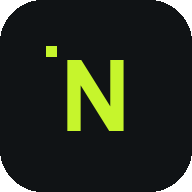
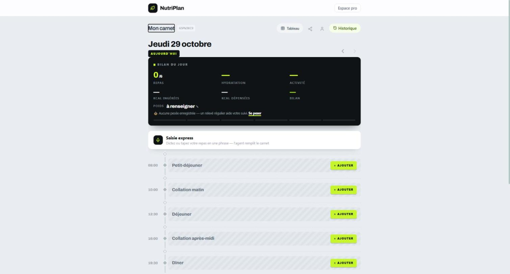
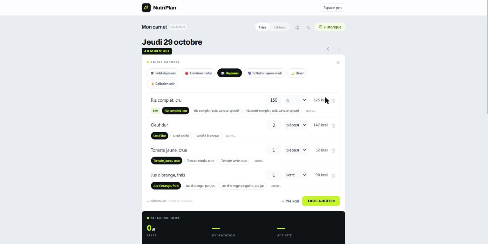
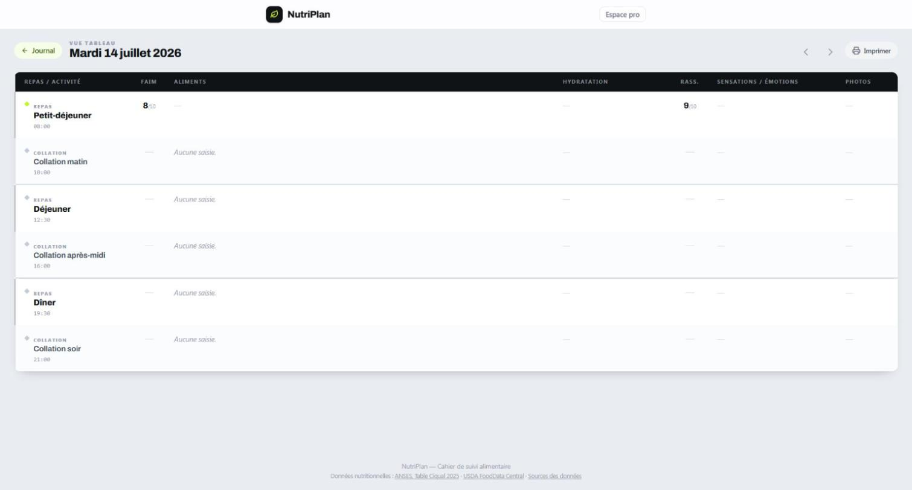
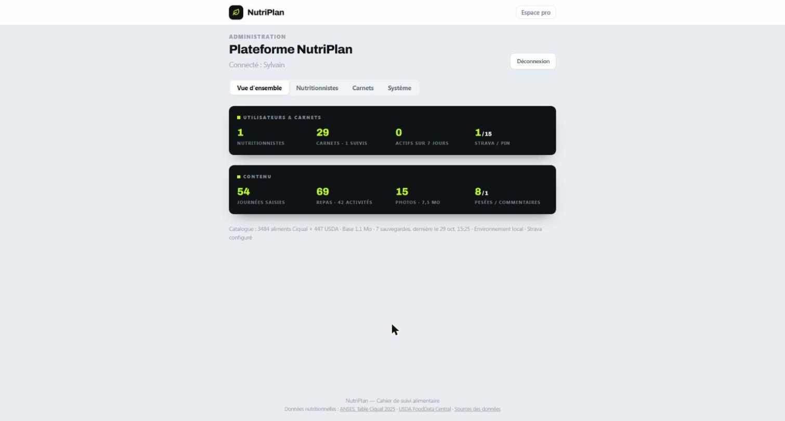

<p align="center">
  
</p>

<h1 align="center">NutriPlan</h1>

<p align="center">
  <b>Carnet de suivi alimentaire</b> — pensé pour le duo patient ↔ nutritionniste.<br/>
  Sans compte, sans e-mail : un code d'accès suffit.
</p>

<p align="center">
  <a href="https://github.com/sbruyere/NutriPlan/actions/workflows/master_nutriplan.yml">
    
  </a>
  
  
  
</p>

---

NutriPlan est une application web progressive (PWA) de **journal alimentaire** : le patient note ses repas, boissons, activités, ressentis et pesées ; le nutritionniste suit, commente et imprime. Les calories et macronutriments sont calculés automatiquement à partir des référentiels publics **Ciqual 2025 (ANSES)** et **USDA FoodData Central** — 3 931 aliments, sans aucune saisie de table nutritionnelle.

| Journal quotidien | Saisie express |
|---|---|
|  |  |

## Fonctionnalités

**Côté patient**
- **Carnet anonyme par code d'accès** (généré cryptographiquement), protégeable par **PIN** (BCrypt, verrouillage après échecs répétés) — aucune création de compte.
- **Journal en frise chronologique** : 6 créneaux de repas, activités intercalées ou simultanées, photos de plats, ressentis faim/satiété, émotions, notes — navigable jour par jour au doigt (pager tactile page à page).
- **Saisie express** : décrivez votre repas en une phrase, au clavier ou à la dictée du téléphone — *« à midi, 150 g de riz complet bio, deux œufs et une tomate »* — l'agent la découpe en aliments structurés (quantités, unités, bio, créneau), les retrouve dans le référentiel et remplit le carnet après votre validation. **Analyse 100 % locale et gratuite par défaut** ; un fournisseur IA (Claude API, OpenAI, Azure OpenAI, OpenRouter) peut prendre le relais s'il est configuré, avec repli local automatique.
- **Bilan du jour** : kcal ingérées/dépensées vs objectifs du profil (Mifflin-St Jeor), hydratation estimée, jauge de repas, pesée rapide avec poids cible et rappel.
- **Strava** : connexion OAuth, import automatique des activités (durée, distance, D+, fréquence cardiaque, Relative Effort), déduction d'intensité.
- **Vue tableau** plein écran pour grands affichages, imprimable (synthèse de la journée en colonnes).
- **PWA installable** (Android/iOS), fonctionne comme une app native.

**Côté nutritionniste**
- Espace dédié : création de carnets patients, tableau de bord d'assiduité, historique complet.
- **Rapport enrichi** : tendances période vs période précédente, courbe de poids avec cible, comparaison jours d'entraînement/repos, signaux d'alerte.
- **Commentaires sur les journées**, avec accusé de lecture et réactions du patient.

**Côté administration**
- Backend complet (`/admin`) : statistiques de la plateforme, gestion des nutritionnistes (suspension, réinitialisation de mot de passe), gestion des carnets (déverrouillage PIN, déliaison Strava, détachement), sauvegardes manuelles, **trousseau de clés IA** (plusieurs clés enregistrées, une active, révocation). Principe : l'administration **gère mais ne consulte jamais** le contenu santé des carnets.

| Vue tableau (grand écran) | Administration |
|---|---|
|  |  |

## Pile technique

- **ASP.NET Core 10 / Blazor Server** — interactivité temps réel sans API REST à maintenir.
- **EF Core + SQLite** — base unique embarquée, sauvegardes quotidiennes automatiques.
- **Tailwind CSS 4** — design system « VOLT » (canvas `#e9edf1`, volt `#c6f52c`, carbon `#101315`).
- **ImageSharp** (photos de repas), **BCrypt.Net** (PIN et mots de passe).
- **CI/CD** : GitHub Actions → Azure App Service (OIDC, sans secret de déploiement longue durée).

## Démarrer en local

Prérequis : [SDK .NET 10](https://dotnet.microsoft.com/download), [Node.js](https://nodejs.org/) (pour Tailwind).

```bash
git clone https://github.com/sbruyere/NutriPlan.git
cd NutriPlan
npm install            # outillage Tailwind
npm run css:build      # génère wwwroot/tailwind.css
dotnet run             # http://localhost:5115
```

La base SQLite et son schéma se créent automatiquement au premier démarrage, référentiel alimentaire inclus (seed `Data/Seed/food-catalog.json`).

**Optionnel — Strava** : créez une application sur [strava.com/settings/api](https://www.strava.com/settings/api), puis :

```bash
dotnet user-secrets set "Strava:ClientSecret" "votre-secret"
```

(le `ClientId` se règle dans `appsettings.json` ; le domaine de callback Strava doit correspondre à votre hôte).

**Optionnel — IA de saisie express** : au premier lancement, ouvrez `/admin` pour créer le compte administrateur, puis onglet *Système → Agent IA* pour enregistrer une clé (par ex. Claude `claude-haiku-5-5`, le plus économique). Sans clé, l'analyse locale fait tout, gratuitement.

## Architecture

```
Components/
  Pages/          DiaryView (journal), DiaryTablePage, Admin/, Nutritionist/
  Shared/         EventCard, ExpressCapture, FoodAutocomplete, DiaryTableView…
Services/
  DiaryService          carnets, journées, repas, calculs nutritionnels
  MealPhraseParser      analyse locale des phrases (sans IA)
  FoodSearch            recherche/classement dans le référentiel
  AiMealParserService   fournisseurs IA optionnels (repli local)
  StravaService         OAuth + import d'activités
  AdminService          backend d'administration
Data/
  Models/               entités EF Core
  Seed/                 référentiel alimentaire (Ciqual + USDA, pré-plié)
```

Choix assumés : pas de migrations EF (schéma gardé à jour par `CREATE TABLE`/`ALTER` idempotents au démarrage), pas d'API publique (tout passe par les circuits Blazor), et le strict minimum de données personnelles — un carnet n'exige ni nom, ni e-mail.

## Données nutritionnelles

- [Table Ciqual 2025](https://ciqual.anses.fr/) — ANSES, licence Etalab 2.0 (3 484 aliments).
- [USDA FoodData Central](https://fdc.nal.usda.gov/) — domaine public (447 aliments traduits en français).

Les attributions détaillées sont sur la page `/donnees` de l'application.

## Sécurité & confidentialité

- Codes d'accès générés par `RandomNumberGenerator`, PIN hachés (BCrypt) avec verrouillage temporaire et délais anti-énumération.
- Secrets (Strava, clés IA) hors du dépôt : `dotnet user-secrets` en local, App Settings en production ; les clés IA vivent en base, masquées à l'affichage et révocables.
- L'administration ne peut pas consulter le contenu santé des carnets.
